# AlphaForge AI — Investment Intelligence Platform

AlphaForge AI is an investment research workspace that brings stock discovery, watchlists, quantitative screening, AI-assisted company research, and portfolio relationship analysis into one application.

> **Important:** AlphaForge AI is a research and educational tool, not financial advice. Historical performance and correlation do not guarantee future outcomes. Strategy templates are starting points, not proven profitable systems.

## Contents

- [Features](#features)
- [Screenshots](#screenshots)
- [System architecture](#system-architecture)
- [Technology stack](#technology-stack)
- [Prerequisites](#prerequisites)
- [Setup and installation](#setup-and-installation)
- [Environment configuration](#environment-configuration)
- [Run locally](#run-locally)
- [Typical workflow](#typical-workflow)
- [Troubleshooting](#troubleshooting)
- [Limitations and future work](#limitations-and-future-work)
- [Team](#team)

## Features

- **Dashboard:** Quick access to reports, saved strategies, and watchlist activity.
- **Stock Search:** Search by ticker, view quote information, technical indicators, and available recent news.
- **Watchlist:** Keep track of tickers and select watchlist holdings for portfolio analysis.
- **Strategy Builder:** Create screening rules, explore technical indicators, and start from research-inspired strategy templates.
- **AI Research:** Generate company-focused research using available market, technical, and news context.
- **Research Reports:** Review a structured summary, technical analysis, and an assessment of which fundamental data is or is not available.
- **Market X-Ray:** Review portfolio weights, sector exposure, historical relationships between holdings, co-movement groups, and automatically surfaced observations.

## Screenshots

The screenshots below document the application UI. They are included in this repository package under `docs/screenshots/`.

### Sign in

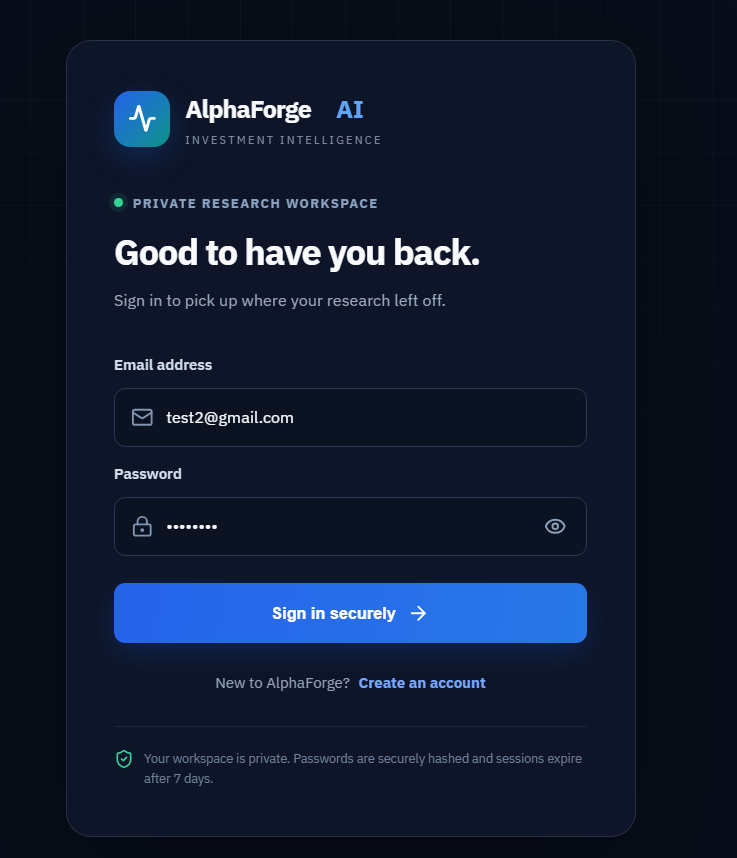

### Dashboard

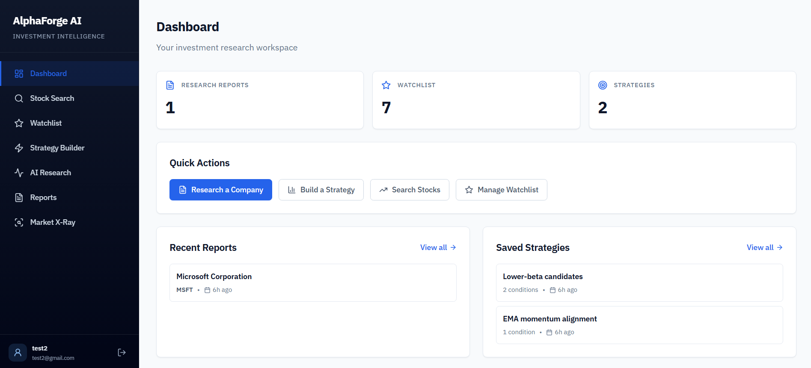

### Stock Search and quote

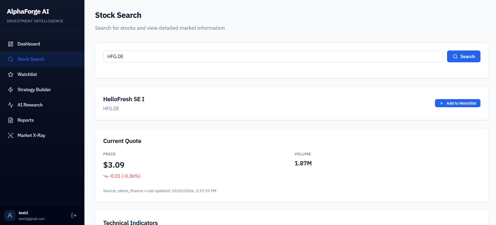

### Technical indicators

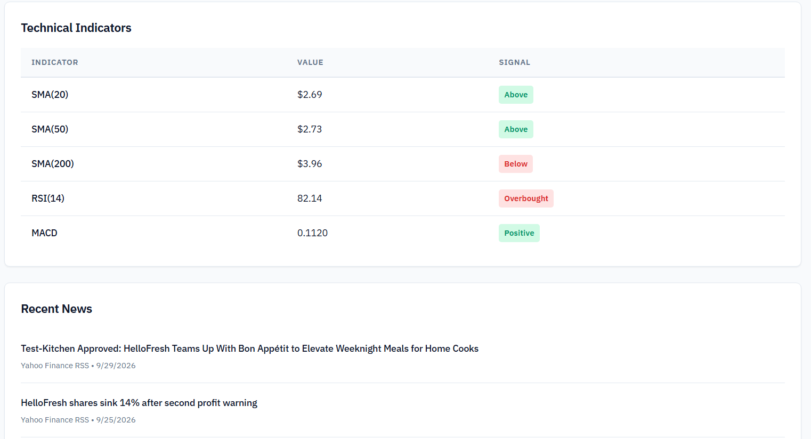

### Watchlist

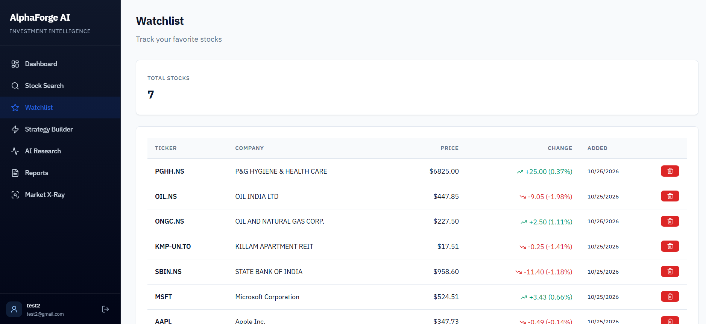

### Strategy Library

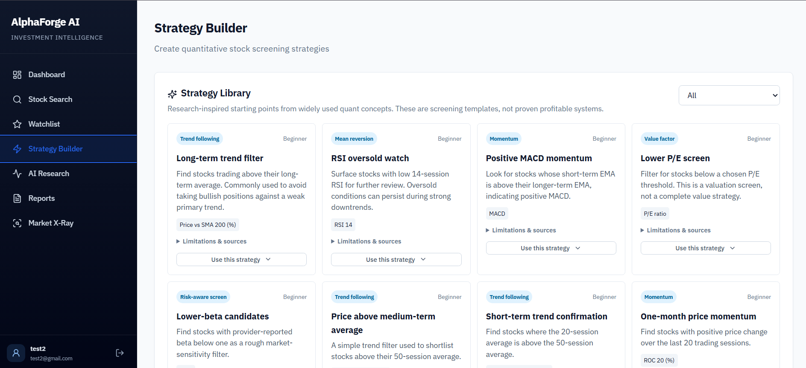

### Strategy Builder and indicator explorer

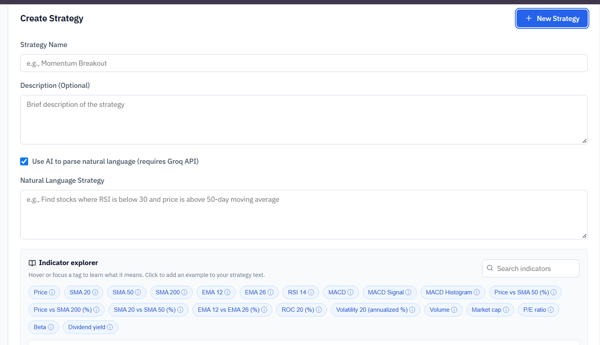

### AI Research

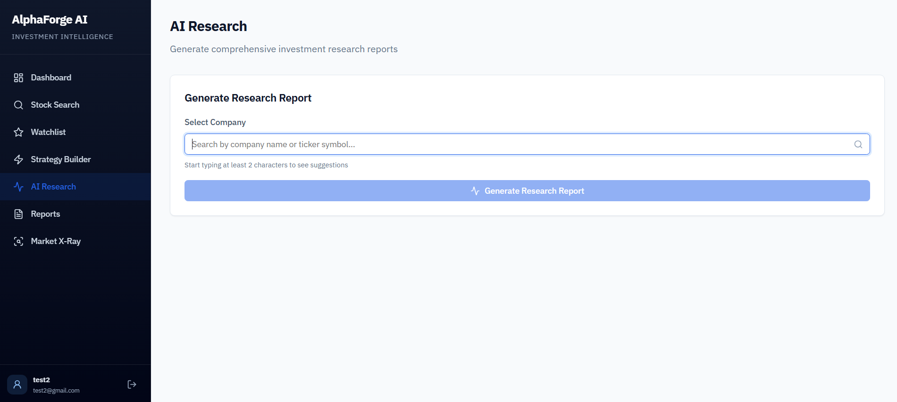

### Generated research report

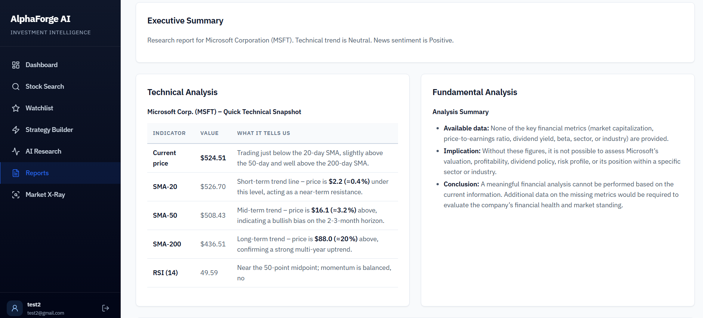

### Market X-Ray: portfolio selection

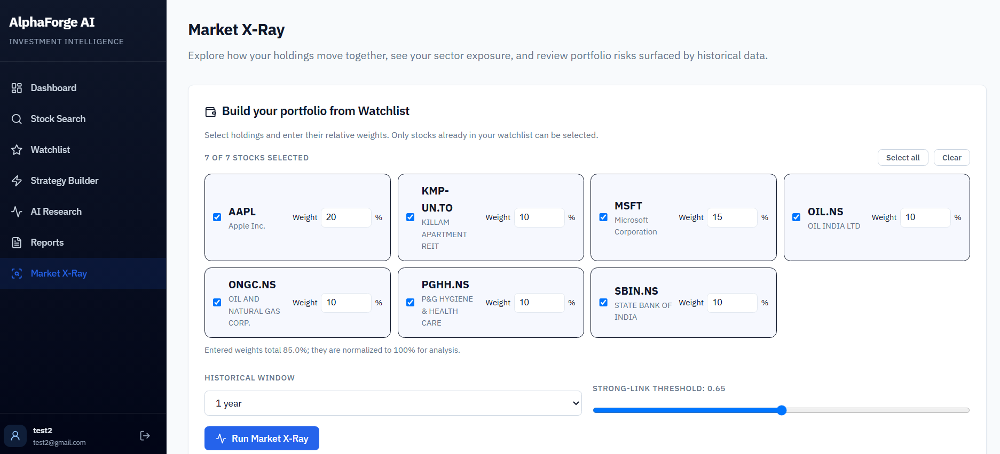

### Market X-Ray: relationship map

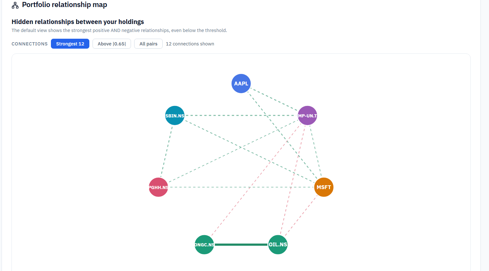

### Market X-Ray: sector exposure

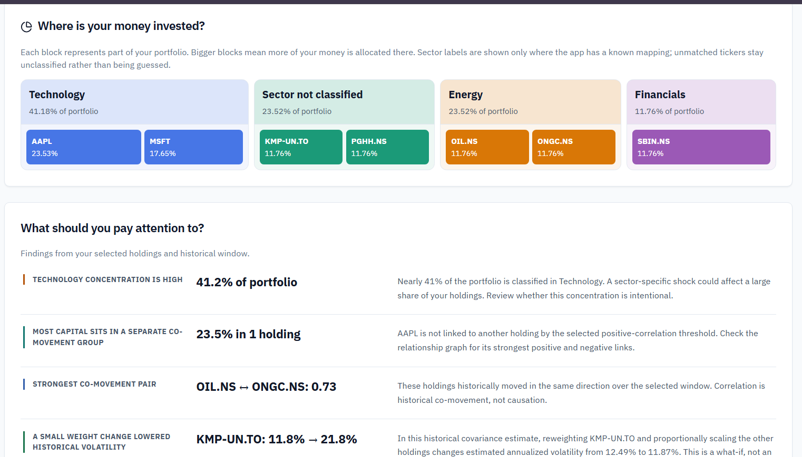

### Market X-Ray: co-movement groups

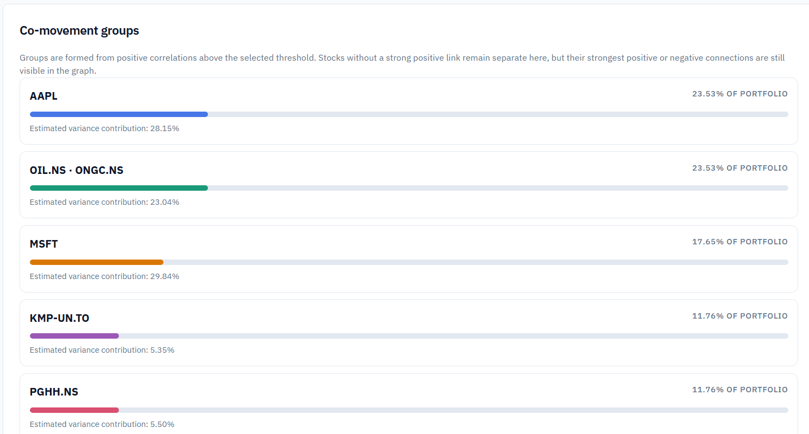

## System architecture

The application follows a frontend/backend architecture. The frontend communicates with the backend over HTTP APIs. The backend coordinates application logic, authentication, market-data retrieval, AI-assisted research, and persistence.

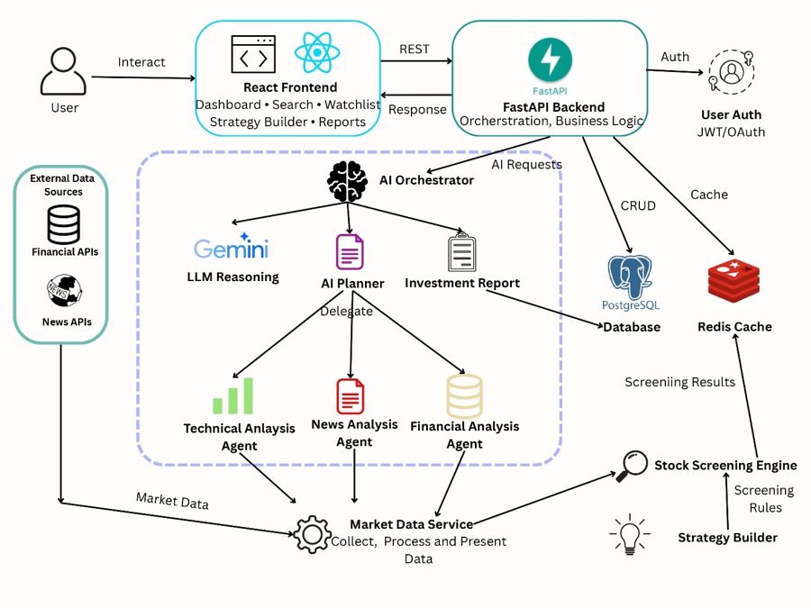

**Architecture note:** This diagram was supplied as the project architecture image. Before using it as a definitive deployment diagram, reconcile provider and infrastructure labels with the current code. In particular, the image contains Gemini and Redis labels, while the current project notes indicate Groq and that Redis was removed. Do not assume a component is deployed solely because it appears in the diagram.

## Technology stack

Based on the project setup and implementation notes:

| Layer | Technology / service | Purpose |
|---|---|---|
| Frontend | React, Vite | Web application and UI |
| Backend | Python, FastAPI | API endpoints and business logic |
| AI provider | Groq API | Natural-language and AI-assisted research tasks |
| Market data | `yfinance` / Yahoo Finance | Quotes and historical market data where available |
| News | NewsData.io and RSS fallback | Recent news context, subject to provider availability |
| Database | PostgreSQL / Neon | Persistent application data |
| Authentication | JWT-based authentication | Authenticated application sessions |

Check the actual `package.json`, Python dependency file, backend configuration, and deployment settings for the exact versions and final service configuration.

## Prerequisites

Install the following before starting:

- Git
- Node.js and npm (use the version specified by the repository if one is pinned)
- Python 3.10+ (use the version specified by the repository if one is pinned)
- Access to the configured PostgreSQL database, such as a Neon database
- API credentials for the AI and news services used by your configuration

You will need the actual project source repository. This README package contains documentation and screenshots, not the application source code.

## Setup and installation

The commands below describe the typical setup for the React/Vite frontend and FastAPI backend. **Use the actual folder names and entry-point module from your repository** if they differ.

### 1. Get the source code

```bash
git clone <YOUR_REPOSITORY_URL>
cd <YOUR_REPOSITORY_DIRECTORY>
```

If you already have the source code locally, open a terminal at the project root instead.

### 2. Configure the backend

Move into the backend folder. Replace `backend` if your repository uses a different directory name.

```bash
cd backend
python -m venv .venv
```

Activate the virtual environment:

**Windows PowerShell**
```powershell
.\.venv\Scripts\Activate.ps1
```

**Windows Command Prompt**
```bat
.\.venv\Scripts\activate.bat
```

**macOS / Linux**
```bash
source .venv/bin/activate
```

Install backend dependencies using the dependency file present in the repository:

```bash
python -m pip install --upgrade pip
pip install -r requirements.txt
```

If the project uses a different dependency file (for example, `pyproject.toml`), follow the repository's instructions instead.

### 3. Configure environment variables

Create a local `.env` file from the project's example file if one exists:

```bash
cp .env.example .env
```

On Windows, you can copy the file in File Explorer or run:

```powershell
Copy-Item .env.example .env
```

Populate the variables required by the backend. Names vary by implementation; use the names read by the project's settings/configuration code.

Example categories of configuration:

```dotenv
# Example only — use the exact names expected by your code.
DATABASE_URL=postgresql+psycopg://<user>:<password>@<host>/<database>
GROQ_API_KEY=<your_groq_api_key>
NEWSDATA_API_KEY=<your_newsdata_api_key>
JWT_SECRET_KEY=<generate_a_long_random_secret>
CORS_ORIGINS=["http://localhost:5173"]
```

**Configuration cautions**
- Do not commit `.env` files or API keys.
- If the settings code parses CORS origins as JSON, provide a valid JSON array, not a comma-separated string.
- The frontend's local URL and port must be allowed by the backend CORS configuration.
- Some projects use a PostgreSQL URL beginning with `postgresql+psycopg://` or another driver-specific scheme. Match the scheme to the installed database driver.
- Do not use the example values above as real credentials.

### 4. Start the backend

From the backend directory, use the FastAPI entry point that actually exists in the repository. For example, if the application object is `app` in `main.py`:

```bash
uvicorn main:app --reload --host 127.0.0.1 --port 8000
```

If it is instead located at `app/main.py`, the command may be:

```bash
uvicorn app.main:app --reload --host 127.0.0.1 --port 8000
```

These are alternatives, not commands to run together. If neither module exists, inspect the project entry point and adjust the import path.

If enabled by the application, FastAPI documentation is commonly available at:

- `http://127.0.0.1:8000/docs`
- `http://127.0.0.1:8000/openapi.json`

Use the health endpoint provided by the project, if available, to verify backend startup and database connectivity.

### 5. Install and start the frontend

Open a second terminal and move to the frontend directory (often `frontend`):

```bash
cd frontend
npm install
```

If the repository contains a lockfile, prefer its reproducible install command:

```bash
npm ci
```

Use **one** install command appropriate to the repository; do not run both without a reason.

Start the Vite development server:

```bash
npm run dev
```

Open the local URL printed by Vite, commonly `http://localhost:5173`.

If the frontend requires an API base URL, configure it using the environment variable expected by the frontend code. Vite-exposed variables commonly begin with `VITE_`, but the exact variable name must come from the application source.

## Environment configuration

At minimum, verify the following in the actual source before running:

| Setting | Why it is needed |
|---|---|
| Database URL | Connects backend persistence to PostgreSQL / Neon |
| Groq API key | Enables configured AI features |
| News provider key | Enables provider-backed news results where configured |
| JWT signing secret | Protects authentication tokens; use a strong secret |
| CORS allowed origins | Allows the local frontend to call the backend |
| Frontend API base URL | Points frontend requests to the running backend |

Some features may degrade gracefully if a provider is unavailable; others may require credentials. Consult the code's settings and error handling for the definitive behavior.

## Run locally

A typical two-terminal workflow:

**Terminal A — backend**
```bash
cd backend
# Activate the virtual environment first
uvicorn main:app --reload --host 127.0.0.1 --port 8000
```

**Terminal B — frontend**
```bash
cd frontend
npm run dev
```

Adjust paths and the Uvicorn module path to match the repository. Sign in with an account created through the app's registration flow, if registration is enabled. Do not use credentials shown in development screenshots as production credentials.

## Typical workflow

1. Open **Stock Search** and search for a ticker.
2. Review the quote, technical indicators, and available news.
3. Add relevant tickers to the **Watchlist**.
4. Use the **Strategy Builder** to select a research-inspired template or define screening conditions.
5. Run **AI Research** for a selected company and review the generated report.
6. Open **Market X-Ray**, select holdings from the watchlist, assign weights, choose a historical window, and run the analysis.
7. Interpret the relationship map and findings as historical observations—not forecasts or causal explanations.

## Troubleshooting

### `ModuleNotFoundError` for a Python package

Activate the project's virtual environment and reinstall the declared dependencies:

```bash
python -m pip install -r requirements.txt
```

Avoid installing project dependencies into a shared global Python environment. Dependency conflicts are easier to isolate in a project-specific virtual environment.

### Invalid CORS settings

Check how the backend parses the CORS setting. If it expects JSON, use a JSON array such as:

```dotenv
CORS_ORIGINS=["http://localhost:5173"]
```

Use the variable name and frontend port expected by your source code.

### Frontend cannot reach the backend

- Confirm the backend is running and its health endpoint responds.
- Confirm the frontend API base URL points to the correct host and port.
- Check CORS configuration.
- Inspect the browser console and backend logs for the failing endpoint.

### AI or news requests fail

- Confirm the required API key is present in the backend environment.
- Check provider quotas, rate limits, network errors, and provider status.
- Verify that the app has a fallback path where one is expected.
- Do not expose provider secrets in frontend variables or client-side code.

### Database connection fails

- Check the database URL, credentials, network access, and SSL requirements.
- Confirm the database is available and any required migrations have been applied.
- Review the backend logs for the original database exception.

### Market data is missing or stale

Third-party market data can be delayed, incomplete, or rate-limited. Confirm the ticker symbol and exchange suffix, check provider output, and distinguish missing data from a genuine zero value.

## Limitations and future work

- Market-data and news coverage depends on the configured providers.
- Technical indicators summarize historical prices and do not predict returns.
- Correlation measures historical co-movement, not causation.
- AI-generated analysis can be incomplete or incorrect and should be checked against source data.
- Strategy-library entries are screening templates, not proof of profitability.
- Future improvements may include reproducible backtesting with transaction costs, benchmark comparisons, richer fundamentals coverage, stronger data-quality checks, and exportable reports.
